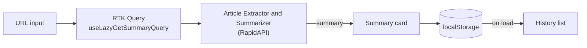

<a name="readme-top"></a>

<div align="center">


# Summify

**Paste an article link, get a summary you can read in under a minute.**

[Live app](https://summify-neon.vercel.app/) · [Demo video](https://github.com/Stroller15/Summify/assets/84174011/6d1b9535-6ba3-411f-99e9-b706088aa01e) · [Run it locally](#run-it-locally)


</div>


## What it does

Summify turns long blog posts and news articles into short, readable summaries. Paste a URL, press Enter, and the app fetches the article, pulls out the main text and returns the key points.

- **Summarize by URL.** No copying and pasting article text. The link is enough.
- **History that sticks.** Every summary is saved in your browser's local storage, so it's still there after a reload, and opening one again costs no API call.
- **Copy and delete.** Copy the summary or any past link with one click, or remove an entry from your history.
- **Works on any screen.** The layout is responsive from phones to wide desktops.

## How it works



1. The form calls a lazy RTK Query endpoint with the article URL.
2. The request goes to the [Article Extractor and Summarizer](https://rapidapi.com/restyler/api/article-extractor-and-summarizer) API on RapidAPI, which extracts the article and summarizes it (`/summarize?url=…&length=3`).
3. The summary is shown and added to the top of the history, which is written to `localStorage` under the key `articles`.
4. On page load the history is read back, so clicking a past link shows its summary straight away.

While a request is running the app shows a loader, and if the API fails it shows the error message instead of a blank card.

## Tech stack

| Area | Tools |
| --- | --- |
| UI | React 18, TypeScript, Tailwind CSS, Lucide icons |
| Data fetching | Redux Toolkit Query |
| Summarization | Article Extractor and Summarizer API (RapidAPI) |
| Build | Vite |
| Hosting | Vercel |

## Run it locally

You need Node.js 24 (see `engines` in `package.json`) and a free RapidAPI key subscribed to the [Article Extractor and Summarizer](https://rapidapi.com/restyler/api/article-extractor-and-summarizer) API.

```bash
git clone https://github.com/Stroller15/summify-ai.git
cd summify-ai
npm install
```

Create `.env` in the project root:

```bash
VITE_RAPID_API_ARTICLE_KEY=your_rapidapi_key
```

Start the dev server:

```bash
npm run dev
```

Open the URL Vite prints, usually [http://localhost:5173](http://localhost:5173).

> [!WARNING]
> Vite builds `VITE_*` variables into the client bundle, so the key is visible to anyone using the deployed site. Use a key with a usage cap, or move the API call behind a serverless function before sharing a production deployment widely.

### Scripts

| Command | What it does |
| --- | --- |
| `npm run dev` | Start the dev server |
| `npm run build` | Type-check and build into `dist/` |
| `npm run preview` | Serve the production build |
| `npm run lint` | ESLint (no warnings allowed) |
| `npm run typecheck` | TypeScript only |

## Project structure

```
src/
  components/
    Hero.tsx         Header and tagline
    Demo.tsx         URL form, summary card and history
    GithubMark.tsx
  services/
    article.ts       RTK Query API definition (RapidAPI)
    store.ts         Redux store
  config.ts          Repository URL
  App.tsx, main.tsx
```

## Architecture


<p align="right">(<a href="#readme-top">back to top</a>)</p>
